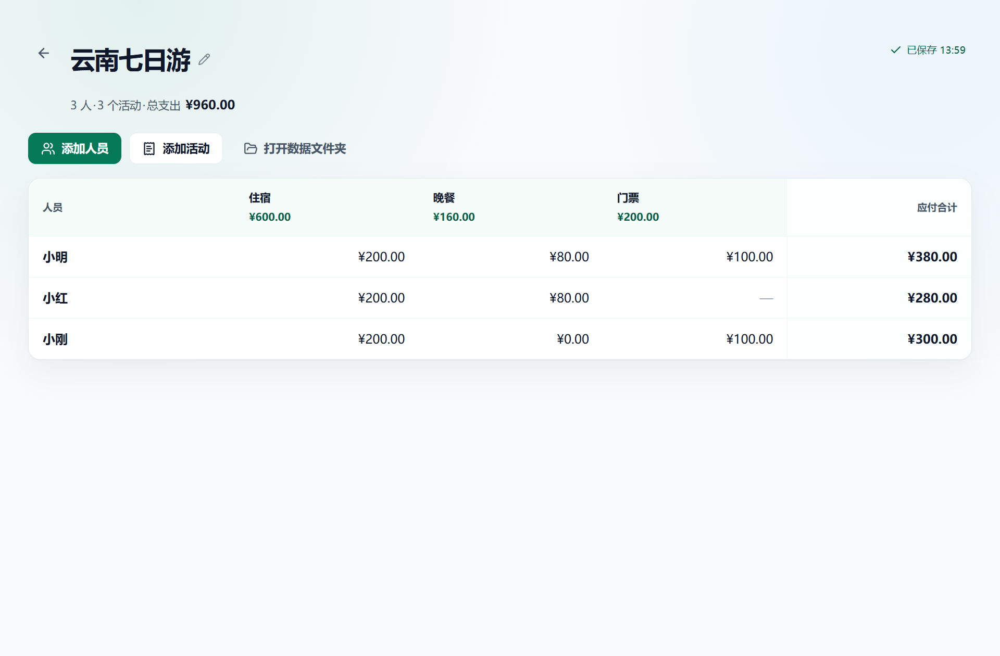
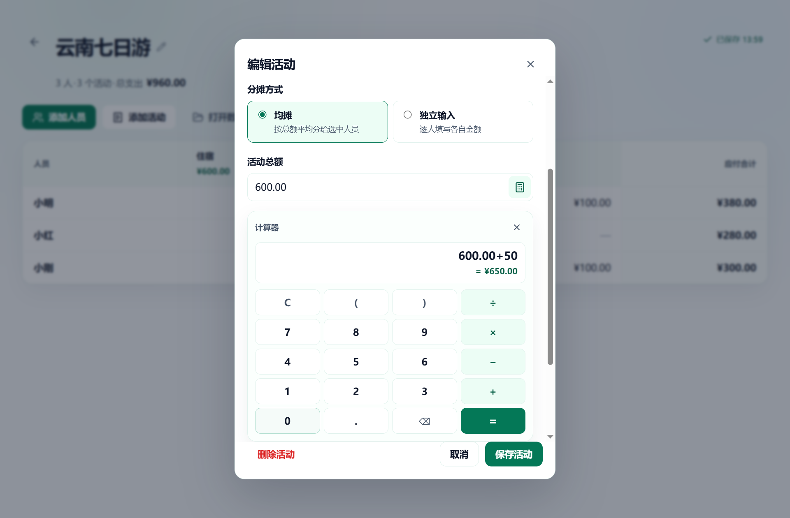
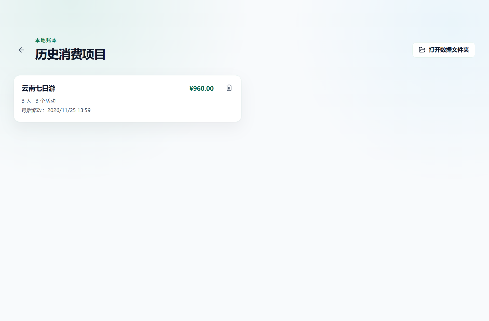

# A钱小工具

一个完全离线的 Windows 桌面工具，用来记录多人出行中的活动和花销，并自动计算每个人应付多少。


## 功能

- 新建消费项目，记录人员和活动。
- 活动支持“均摊”和“独立输入”两种分摊方式。
- 总览表格显示每个人在每个活动中的金额，以及每人应付合计。
- 金额输入内置计算器，支持加、减、乘、除、括号和键盘输入。
- 历史项目可重新打开继续编辑。
- 所有修改自动保存，无需手动点保存。
- 项目文件保存在本机，不登录、不联网、不含遥测。



## 下载与安装

从本仓库的 **Releases** 页面下载最新的 Windows 安装包：

```text
Aqian-Tool-Setup-1.0.0.exe
```

本地构建时会另外生成一个便于识别的副本：

```text
release\A钱小工具-Setup-1.0.0.exe
```

- 支持 Windows 10/11 x64。
- 按当前用户安装，不需要管理员权限。
- 使用系统 WebView2；Windows 10/11 通常已自带。
- 当前安装包未购买代码签名证书，Windows 可能显示“未知发布者”或 SmartScreen 提示。请从本仓库的 Releases 下载，并核对 SHA256。

## 使用

1. 新建消费项目并输入项目名称。
2. 添加参与人员。
3. 添加活动，选择参与人员，输入金额。
4. 选择均摊或独立输入。
5. 在项目总览中查看每人应付合计。

### 计算器

活动总额和独立输入的每个人金额框右侧都有计算器按钮。支持：

- `+ − × ÷`
- 括号
- 小数
- 退格、清空
- 键盘输入
- Enter 计算、Esc 关闭



### 历史项目



## 数据位置

默认位置：

```text
文档\A钱小工具\projects\
```

每个项目是一个 JSON 文件。复制整个 `文档\A钱小工具` 文件夹即可迁移数据。

卸载软件不会删除这个文件夹。

> Tauri 1.0 版本与旧 Electron 版使用同一个数据目录，因此升级后原有项目会直接出现在历史中。

## 开发

环境要求：

- Node.js 22+
- Rust stable MSVC 工具链
- Visual Studio Build Tools 的“使用 C++ 的桌面开发”工作负载
- WebView2 Runtime

```powershell
npm install
npm run tauri dev
```

如果 PowerShell 找不到 MSVC 链接器，请先进入 Visual Studio 的 x64 开发者命令提示符，或加载 `vcvars64.bat`。

## 测试

```powershell
npm test
npm run typecheck
cargo test --manifest-path src-tauri/Cargo.toml
```

## 构建安装包

```powershell
npm run tauri build
```

产物：

```text
release\A钱小工具-Setup-1.0.0.exe
```

安装包约 1.5 MiB，主程序约 4.3 MB；不包含 Chromium，使用系统 WebView2。

## 发布

推送 `vX.Y.Z` 标签后，GitHub Actions 会：

- 在 Windows 上构建 NSIS 安装包
- 创建 GitHub Release
- 上传安装包
- 生成 SHA256 校验文件

详细步骤见 `CONTRIBUTING.md`。

## 隐私

- 不登录、不联网、无遥测。
- 项目数据只保存在本机。
- 应用不会上传项目内容。

更多见 `SECURITY.md`。

## 许可证

[MIT](LICENSE) © 2026 ylyin
